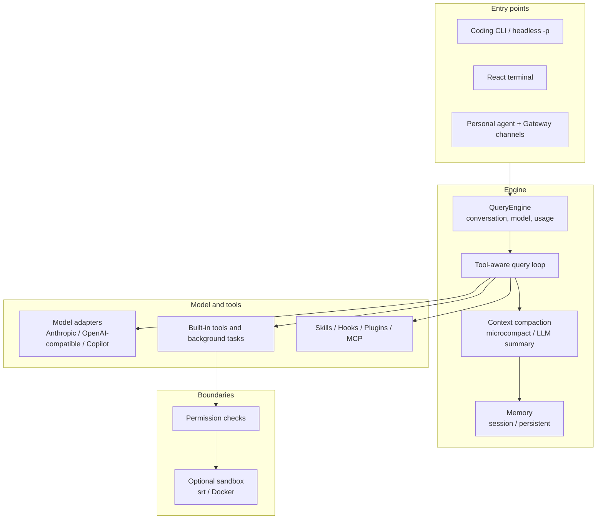

<div align="center">

# Guyline

**An extensible local AI agent harness**

Connecting models, tool execution, context management and multi-agent collaboration
into one runtime you can run and extend.

[](https://github.com/imddn/Guyline/actions/workflows/ci.yml)
[](pyproject.toml)
[](LICENSE)

[中文](README.md) · [English](README.en.md) · [Architecture](docs/ARCHITECTURE.en.md) · [Examples](docs/SHOWCASE.md) · [Contributing](CONTRIBUTING.md) · [Security](SECURITY.md)

</div>

---

## What Guyline Is

Guyline is an agent harness that runs locally. It is not just a chat interface: it
wires the pieces needed for a model to read files, run commands, edit code and keep
context into one runnable system — a unified execution loop, tool calls, permission
decisions, context and memory management, extension loading, and several entry points.

It is written mainly for two audiences:

- agent developers who need to connect models to real toolchains with control over
  permissions and cost;
- technical reviewers evaluating agent-runtime design and tradeoffs.

Guyline does not train models and does not replace model capability; it provides the
runtime, boundaries and observability between a model and the real environment.

## Core Capabilities

| Capability | What it does | Source |
| --- | --- | --- |
| Execution loop | Streams model output → runs tool calls → feeds results back → continues until the model stops, a turn limit is hit, or an error surfaces | [`src/guyline/engine/`](src/guyline/engine/) |
| Multi-agent collaboration | The `agent` tool path always dispatches a subprocess teammate (so background tasks can poll it); in-process teammates, a shared mailbox, team lifecycle and background tasks are also available | [`src/guyline/swarm/`](src/guyline/swarm/), [`src/guyline/tasks/`](src/guyline/tasks/) |
| Context and memory | Microcompact and LLM-summarized compaction, session memory, persistent project memory and background consolidation | [`src/guyline/services/compact/`](src/guyline/services/compact/), [`src/guyline/memory/`](src/guyline/memory/) |
| Permissions and optional sandbox | Permission modes and path rules; sandboxing is off by default and, when enabled, comes from an external `srt` runtime or a Docker backend | [`src/guyline/permissions/`](src/guyline/permissions/), [`src/guyline/sandbox/`](src/guyline/sandbox/) |
| Extensions | Discovery and loading of Skills, Hooks, Plugins and MCP servers | [`src/guyline/skills/`](src/guyline/skills/), [`src/guyline/hooks/`](src/guyline/hooks/), [`src/guyline/plugins/`](src/guyline/plugins/), [`src/guyline/mcp/`](src/guyline/mcp/) |
| Entry points | Coding CLI, headless `-p`, React terminal, personal agent and Gateway channels | [`src/guyline/cli.py`](src/guyline/cli.py), [`src/guyline/ui/`](src/guyline/ui/), [`src/guyline/agent/`](src/guyline/agent/) |

For the full mechanism, tradeoffs and test entry points, see the
[architecture document](docs/ARCHITECTURE.en.md).

## Quick Start

### 1. Prerequisites

- **Python 3.10+** (package metadata uses `requires-python = ">=3.10"`).
- **uv**, used for the recommended environment workflow. If it is not installed yet,
  see the [uv installation guide](https://docs.astral.sh/uv/getting-started/installation/),
  for example `curl -LsSf https://astral.sh/uv/install.sh | sh`.
- **Node.js 20+ and npm**, only needed for the React terminal or for building the
  autopilot dashboard. The React terminal pulls in `marked` (`engines.node >= 20`),
  so the terminal itself needs Node 20+ (22 LTS recommended; `ink` alone asks for
  >= 18), while the dashboard uses Vite 6 (Node 18/20/22). A Python-only install can
  still use the CLI, `-p` and `python -m guyline`.

### 2. Install from source

Guyline installs from a source checkout or a local wheel; a published PyPI package is
not required.

```bash
git clone https://github.com/imddn/Guyline.git
cd Guyline
uv sync --extra dev

# Optional: install the React terminal
cd frontend/terminal && npm ci && cd ../..

uv run guyline --version
```

You can also run `python -m pip install -e .` inside a virtual environment. The
repository also ships installers that use only a local source path or an explicit
wheel (they create `.guyline-venv` and register only the `guyline` launcher):

```bash
bash scripts/install.sh --source "/path/to/local checkout"
bash scripts/install_dev.sh --global-venv
uv build --wheel
bash scripts/install.sh --wheel "/path/to/guyline-0.2.0-py3-none-any.whl"
```

PowerShell takes the same local paths through `-Source` / `-Wheel`.

### 3. Credential-free checks

These two commands never call a model or run a tool, so they work before any provider
is configured:

```bash
uv run guyline --version
uv run guyline --dry-run -p "/help"   # resolves config/skills/commands/tools; no model call
```

### 4. Configure one provider

`--dry-run` only previews the resolved runtime. To actually get an answer you need at
least one working provider:

```bash
uv run guyline setup          # interactive: choose workflow, authenticate, pick model
uv run guyline provider list  # list configured provider profiles
uv run guyline auth status    # show the active auth source
```

Prefer the interactive `guyline setup` or `guyline auth login` flows: credentials
typed at a prompt do not land in shell history the way a `--api-key` argument does.
Examples here use placeholders only — never commit a real token to a repository,
script or issue.

### 5. First prompt

```bash
uv run guyline                                # interactive coding CLI
uv run guyline -p "Explain this repository"   # non-interactive; needs a configured provider
```

`guyline -p` calls the configured model and may incur provider cost; it cannot answer
without a provider. Non-interactive mode supports
`--output-format text|json|stream-json` for scripted use.

## Common Scenarios

**Interactive coding** — start the CLI inside a repository and let the model read
files, edit code, run tests and iterate on the results. Good for medium tasks that
benefit from back-and-forth confirmation.

**Headless automation** — use `-p` with structured output from scripts or CI.

```bash
# Example prompt (needs a configured provider)
uv run guyline -p "Summarize this repository" --output-format json
```

**Multi-agent tasks** — split one task across several teammates that explore or
implement in parallel while the main session collects results through the team and
mailbox. The prompt below is only an example; it is not a built-in demo.

```text
# Example prompt (needs a configured provider)
Split "analyze this repository's module structure" into two parallel subtasks and
summarize the results into one report.
```

**Personal agent and Gateway** — `guyline agent` runs the long-lived personal agent,
and `guyline gateway` manages its lifecycle for chat channels such as
Feishu/Slack/Telegram (depending on the channel implementation and configuration).

```bash
uv run guyline agent           # personal agent
uv run guyline gateway run     # run the Gateway in the foreground
uv run guyline gateway status
```

## Architecture Overview



Each layer's implementation, tradeoffs and source/test entry points are covered in the
[architecture document](docs/ARCHITECTURE.en.md); minimal examples live in
[SHOWCASE](docs/SHOWCASE.md).

## Development And Validation

```bash
uv run pytest -q                       # offline by default; real-API tests skip
uv run ruff check src tests scripts

cd frontend/terminal
npm ci && npm run typecheck && npm test

cd ../../autopilot-dashboard
npm ci && npm run build
```

Real-API tests are opt-in and skipped by default: set `GUYLINE_RUN_REAL_API=1`, a
non-empty `ANTHROPIC_API_KEY`, and point `GUYLINE_REAL_WORKSPACE` at a local checkout.
Docker sandbox end-to-end tests need a working Docker daemon and are an extra
prerequisite. The default `pytest` run does not contact a model.

## Documentation Map

| Document | Contents |
| --- | --- |
| [docs/ARCHITECTURE.en.md](docs/ARCHITECTURE.en.md) | Execution loop, multi-agent, context and memory, permissions and sandbox, extensions; plus a paths and environment appendix |
| [docs/ARCHITECTURE.md](docs/ARCHITECTURE.md) | Chinese version of the architecture document |
| [docs/SHOWCASE.md](docs/SHOWCASE.md) | Small reproducible examples |
| [CONTRIBUTING.md](CONTRIBUTING.md) | Development workflow, validation commands, real-API and platform boundaries |
| [SECURITY.md](SECURITY.md) | Credential, log, plugin and sandbox requirements, and how to report issues |
| [CHANGELOG.md](CHANGELOG.md) | Release notes |

## Known Limitations

- There is no credential-free model path: a real prompt needs a configured provider
  with valid credentials.
- Real-API and Docker sandbox tests need extra local prerequisites and are not part of
  the default offline run.
- Sandboxing is off by default (`sandbox.enabled=False`). Even when enabled, if the
  external `srt`/Docker runtime is unavailable and failure is not requested, Guyline
  is allowed to run without the sandbox; only setting `sandbox.fail_if_unavailable`
  (or `GUYLINE_SANDBOX_FAIL_IF_UNAVAILABLE`) makes it a hard failure.
- Token estimation and LLM summaries are lossy; compaction does not guarantee that
  every detail survives.
- Platform support follows the CI matrix that actually runs; native Windows
  file-storage behavior is covered only by the Windows CI job, and a Linux run is not
  a substitute.
- The autopilot workflows run on a self-hosted runner and only trigger manually. They
  are an optional maintainer tool, not a default product dependency.

## Contributing And License

- Contribution workflow: [CONTRIBUTING.md](CONTRIBUTING.md); security issues:
  [SECURITY.md](SECURITY.md).
- Guyline is released under the [MIT license](LICENSE), copyright imddn.
- The channel components are derived from
  [nanobot-ai/nanobot](https://github.com/nanobot-ai/nanobot) (MIT). Provenance is
  recorded in [`src/guyline/channels/UPSTREAM`](src/guyline/channels/UPSTREAM) and the
  license text is kept in
  [`src/guyline/channels/LICENSE.nanobot`](src/guyline/channels/LICENSE.nanobot).
