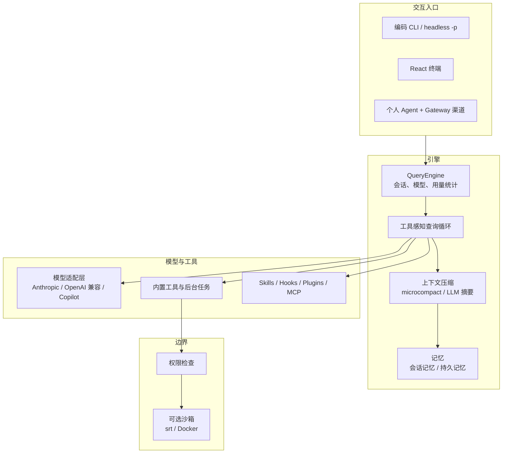

<div align="center">

# Guyline

**可扩展的本地 AI Agent Harness**

把模型接入、工具执行、上下文管理与多 Agent 协作组织成一套可运行、可扩展的系统。

[](https://github.com/imddn/Guyline/actions/workflows/ci.yml)
[](pyproject.toml)
[](LICENSE)

[中文](README.md) · [English](README.en.md) · [架构文档](docs/ARCHITECTURE.md) · [示例](docs/SHOWCASE.md) · [贡献指南](CONTRIBUTING.md) · [安全策略](SECURITY.md)

</div>

---

## Guyline 是什么

Guyline 是一个在本地运行的 Agent Harness。它不只是一个聊天界面，而是把「模型
能读文件、跑命令、改代码、记住上下文」这条链路所需的组件串成一套可运行的系统：
统一执行循环、工具调用、权限判定、上下文与记忆管理、扩展加载，以及多交互入口。

它主要面向两类读者：

- 需要把模型接入真实工具链、并控制权限与成本的 Agent 开发者；
- 评估 agent runtime 设计与取舍的技术评审。

Guyline 不做模型训练，也不代替模型能力；它提供的是模型与真实环境之间的运行时、
边界和可观测性。

## 核心能力

| 能力 | 负责什么 | 源码入口 |
| --- | --- | --- |
| 执行循环 | 流式模型输出 → 工具调用 → 结果回填 → 继续推理，直到模型停止、达到轮数上限或出错 | [`src/guyline/engine/`](src/guyline/engine/) |
| 多 Agent 协作 | `agent` 工具路径始终派发子进程 teammate（便于后台任务轮询），另有 in-process teammate、共享 mailbox、团队生命周期与后台任务 | [`src/guyline/swarm/`](src/guyline/swarm/)、[`src/guyline/tasks/`](src/guyline/tasks/) |
| 上下文与记忆 | microcompact 与 LLM 摘要压缩、会话记忆、项目持久记忆与后台整理 | [`src/guyline/services/compact/`](src/guyline/services/compact/)、[`src/guyline/memory/`](src/guyline/memory/) |
| 权限与可选沙箱 | 权限模式与路径规则；沙箱默认关闭，启用后由外部 `srt` 或 Docker 后端提供 | [`src/guyline/permissions/`](src/guyline/permissions/)、[`src/guyline/sandbox/`](src/guyline/sandbox/) |
| 扩展机制 | Skills、Hooks、Plugins、MCP server 的发现与加载 | [`src/guyline/skills/`](src/guyline/skills/)、[`src/guyline/hooks/`](src/guyline/hooks/)、[`src/guyline/plugins/`](src/guyline/plugins/)、[`src/guyline/mcp/`](src/guyline/mcp/) |
| 多交互入口 | 编码 CLI、headless `-p`、React 终端、个人 Agent 与 Gateway 渠道 | [`src/guyline/cli.py`](src/guyline/cli.py)、[`src/guyline/ui/`](src/guyline/ui/)、[`src/guyline/agent/`](src/guyline/agent/) |

更完整的机制说明、取舍和测试入口见[架构文档](docs/ARCHITECTURE.md)。

## 快速开始

### 1. 前置条件

- **Python 3.10+**（包元数据为 `requires-python = ">=3.10"`）。
- **uv**：本仓库推荐用 uv 管理环境。若尚未安装，见
  [uv 安装说明](https://docs.astral.sh/uv/getting-started/installation/)，例如
  `curl -LsSf https://astral.sh/uv/install.sh | sh`。
- **Node.js 20+ 与 npm**：仅在使用 React 终端或构建 autopilot dashboard 时需要。
  React 终端依赖 `marked`（`engines.node >= 20`，因此终端实际需要 Node 20+，推荐
  22 LTS；`ink` 自身要求 >= 18）；dashboard 使用 Vite 6（支持 Node 18/20/22）。
  不安装前端也能使用 CLI、`-p` 和 `python -m guyline`。

### 2. 从源码安装

Guyline 通过源码 checkout 或本地 wheel 安装，不依赖已发布的 PyPI 包。

```bash
git clone https://github.com/imddn/Guyline.git
cd Guyline
uv sync --extra dev

# 可选：安装 React 终端
cd frontend/terminal && npm ci && cd ../..

uv run guyline --version
```

也可以在虚拟环境中执行 `python -m pip install -e .`。仓库还提供只用本地源码或显式
wheel 的安装脚本（默认创建 `.guyline-venv`，只注册 `guyline` 启动器）：

```bash
bash scripts/install.sh --source "/本地/源码目录"
bash scripts/install_dev.sh --global-venv
uv build --wheel
bash scripts/install.sh --wheel "/本地/guyline-0.2.0-py3-none-any.whl"
```

PowerShell 使用 `-Source` / `-Wheel` 传入本地路径，参数含义相同。

### 3. 无凭据检查

下面两条命令不调用模型、不执行工具，可以在配置任何 provider 之前运行：

```bash
uv run guyline --version
uv run guyline --dry-run -p "/help"   # 解析配置/skills/命令/工具；不调用模型
```

### 4. 配置一个 provider

`--dry-run` 只预览解析结果；真正获得回答前需要至少一个可用 provider。

```bash
uv run guyline setup          # 交互式：选择工作流、完成认证、选择模型
uv run guyline provider list  # 列出已配置的 provider 档案
uv run guyline auth status    # 查看当前认证来源
```

建议通过交互式 `guyline setup` 或 `guyline auth login` 输入凭据，而不是把 token
写进命令行——命令会进入 shell 历史。示例一律使用占位符，不要把真实 token 提交到
仓库、脚本或 issue。

### 5. 第一条提示

```bash
uv run guyline                                # 交互式编码 CLI
uv run guyline -p "Explain this repository"   # 非交互；需要已配置的 provider
```

`guyline -p` 会调用已配置的模型，可能产生 provider 费用；未配置 provider 时无法回答。
非交互模式支持 `--output-format text|json|stream-json`，便于脚本消费。

## 典型场景

**交互式编码**：在仓库里启动 CLI，让模型读文件、改代码、跑测试并根据结果继续。
适合需要来回确认的中等任务。

**headless 自动化**：用 `-p` 加结构化输出接入脚本或 CI。

```bash
# 示例提示词（需已配置 provider）
uv run guyline -p "Summarize this repository" --output-format json
```

**多 Agent 任务**：把一个任务拆给多个 teammate 并行探索或实现，主会话通过团队与
mailbox 汇总结果。以下提示词只是示例写法，不代表仓库内置固定演示：

```text
# 示例提示词（需已配置 provider）
把“分析这个仓库的模块结构”拆成两个子任务并行执行，最后汇总成一份报告。
```

**个人 Agent 与 Gateway**：`guyline agent` 运行长期存在的个人 Agent，
`guyline gateway` 管理它的生命周期，用于把 Agent 接到 Feishu/Slack/Telegram 等
渠道（依渠道实现与配置而定）。

```bash
uv run guyline agent           # 个人 Agent
uv run guyline gateway run     # 前台运行 Gateway
uv run guyline gateway status
```

## 架构总览



各层的实现方式、设计取舍与源码/测试入口见[架构文档](docs/ARCHITECTURE.md)；
最小示例见[示例文档](docs/SHOWCASE.md)。

## 开发与验证

```bash
uv run pytest -q                       # 默认离线；真实 API 测试自动跳过
uv run ruff check src tests scripts

cd frontend/terminal
npm ci && npm run typecheck && npm test

cd ../../autopilot-dashboard
npm ci && npm run build
```

真实 API 测试默认跳过，需显式 opt-in：设置 `GUYLINE_RUN_REAL_API=1`、非空
`ANTHROPIC_API_KEY`，并把 `GUYLINE_REAL_WORKSPACE` 指向一个本地 checkout。
Docker 沙箱端到端测试需要可用的 Docker daemon，属于额外前提。默认 `pytest`
不访问模型。

## 文档导航

| 文档 | 内容 |
| --- | --- |
| [docs/ARCHITECTURE.md](docs/ARCHITECTURE.md) | 执行循环、多 Agent、上下文与记忆、权限与沙箱、扩展机制；附路径与环境变量附录 |
| [docs/ARCHITECTURE.en.md](docs/ARCHITECTURE.en.md) | 架构文档英文版 |
| [docs/SHOWCASE.md](docs/SHOWCASE.md) | 可复现的小示例 |
| [CONTRIBUTING.md](CONTRIBUTING.md) | 开发流程、验证命令、真实 API 与平台边界 |
| [SECURITY.md](SECURITY.md) | 凭据、日志、插件与沙箱的安全要求与漏洞报告方式 |
| [CHANGELOG.md](CHANGELOG.md) | 变更记录 |

## 已知限制

- 不存在无需凭据的模型路径：真实提示必须有一个配置了有效凭据的 provider。
- 真实 API 与 Docker 沙箱测试需要额外本地前提，不属于默认离线测试。
- 沙箱默认关闭（`sandbox.enabled=False`）。即使启用，当外部 `srt`/Docker 运行时不可用
  且未要求失败时，Guyline 允许在无沙箱的情况下执行；只有显式设置
  `sandbox.fail_if_unavailable`（或 `GUYLINE_SANDBOX_FAIL_IF_UNAVAILABLE`）才会硬失败。
- Token 估算与 LLM 摘要有损，压缩后不保证保留全部细节。
- 平台支持以实际运行的 CI 矩阵为准；Windows 原生文件存储行为仅由 Windows CI
  job 覆盖，Linux 模拟不能替代。
- Autopilot 相关 workflow 运行在自托管 runner 上且仅手动触发，属于受信维护者的
  可选工具，不是默认产品运行依赖。

## 贡献与许可证

- 贡献流程见 [CONTRIBUTING.md](CONTRIBUTING.md)，安全问题见 [SECURITY.md](SECURITY.md)。
- Guyline 以 [MIT 许可证](LICENSE)发布，版权归 imddn。
- 渠道组件派生自 [nanobot-ai/nanobot](https://github.com/nanobot-ai/nanobot)
  （MIT），来源记录保留在 [`src/guyline/channels/UPSTREAM`](src/guyline/channels/UPSTREAM)，
  许可证文本见 [`src/guyline/channels/LICENSE.nanobot`](src/guyline/channels/LICENSE.nanobot)。
